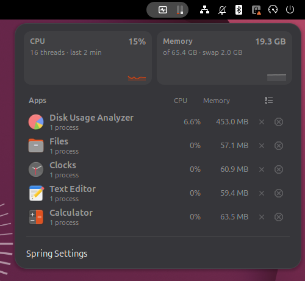
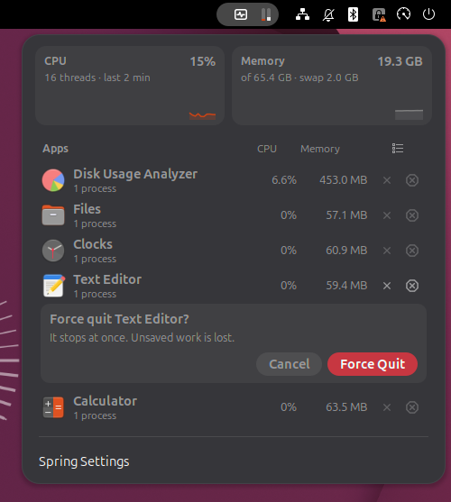
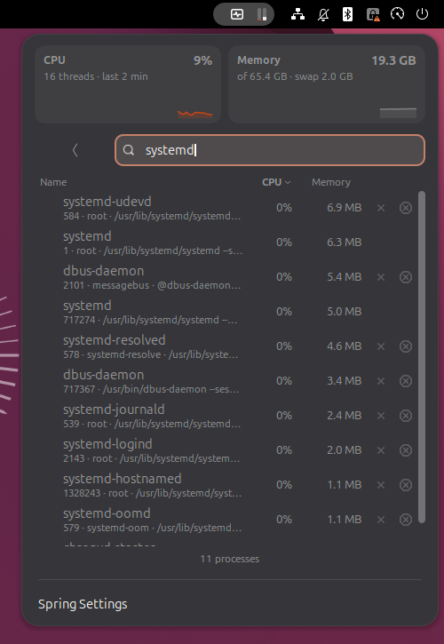
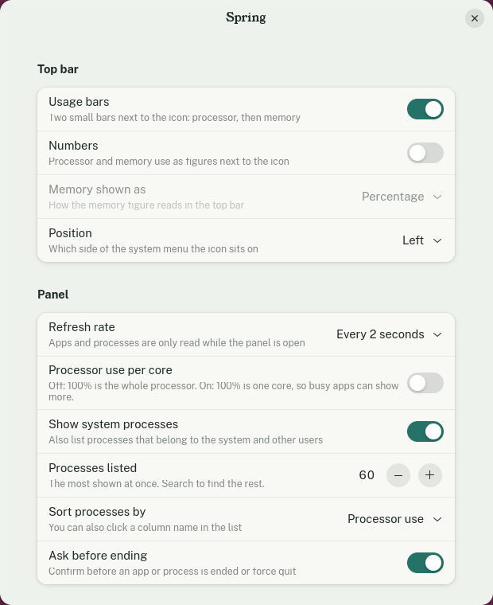

# Spring

*Part of the Sedge family of webhookstudios apps.*

A task manager in the GNOME top bar. Spring shows processor and memory use at a glance, lists every open app with the processor and memory it uses, and lets you end or force quit anything that hangs, from a searchable list of all processes.



| Asking before it ends anything | Every process, with search |
|---|---|
|  |  |

## Requirements

- GNOME Shell 50 (Ubuntu 26.04)
- A Wayland session, which is the Ubuntu default

Spring has only been tested on Ubuntu 26.04 with GNOME Shell 50.1 on Wayland.

## Install

### With the deb package (recommended)

Download `spring-monitor_1.0.1_all.deb` from the [latest release](https://github.com/webhookstudios/spring/releases/latest), then install it:

```bash
sudo apt install ./spring-monitor_1.0.1_all.deb
```

Log out and back in, then open **Spring** from the apps menu. The first time, that turns Spring on and opens its settings.

The package is called `spring-monitor`, because Ubuntu already has an unrelated package called `spring`. To remove it:

```bash
sudo apt remove spring-monitor
```

### As an extension zip, without root

```bash
wget https://github.com/webhookstudios/spring/releases/latest/download/spring@webhookstudios.github.io.shell-extension.zip
```

```bash
gnome-extensions install --force spring@webhookstudios.github.io.shell-extension.zip
```

Log out and back in, then:

```bash
gnome-extensions enable spring@webhookstudios.github.io
```

Installed this way, ending a process of another user still asks for your password, with the system's general message instead of Spring's own.

### From source

```bash
git clone https://github.com/webhookstudios/spring.git
```

```bash
./spring/install.sh
```

## Using it

Spring's icon, a screen with a pulse line, sits in the top bar just left of the system menu. Next to it, two thin bars show how busy the processor is and how full the memory is. Turn on **Numbers** in the settings to also see both as figures.


Click the icon to open the panel:

- **CPU** and **Memory** at the top show the use right now and a graph of the last few minutes.
- **Apps** lists every open app, busiest first, with its processor and memory use. An app that runs several processes, like a web browser, is one row with all of them added up.
- **End** (the × button) asks an app to quit, as if you closed it, so it can ask you to save your work first.
- **Force quit** (the stop sign) stops an app and all of its processes at once. Use it when an app has stopped responding. Unsaved work is lost.
- **All processes** (the list button) shows everything running, not only apps. Search by name, command or process number, and click **Name**, **CPU** or **Memory** to sort. Each process has its own End and Force quit.

Spring asks before it ends anything. Processes of the system or another user ask for your password first. Spring will not end the desktop shell itself or the system's first process.

The list holds still while the pointer is on it, so a row does not move away just as you click it.

## Settings

Open **Spring** from the apps menu, choose **Spring Settings** at the bottom of the panel, or run:

```bash
gnome-extensions prefs spring@webhookstudios.github.io
```



| Group | What you can change |
|---|---|
| Top bar | The usage bars, the numbers, memory as a percentage or an amount, which side of the system menu the icon sits on |
| Panel | How often it updates (every 1 to 10 seconds), processor use per core, whether system processes are listed, how many processes are listed at once, how they are sorted, asking before ending |

Changes apply straight away.

## How it works

Spring reads the same figures the system keeps for every process, in `/proc`. It never slows the desktop down:

- The top bar reads two small files every few seconds, in the background.
- The per-app and per-process figures are read by a small separate helper process that only runs while the panel is open. With the panel closed, it costs nothing.
- GNOME starts each app in its own group of processes, which the system counts as a whole. Spring uses those totals, so an app's figures include every process it started. Memory leaves out the file cache, which the system frees by itself when memory runs short.
- End asks the app to quit through GNOME; for a process, it sends the polite stop signal. Force quit stops every process in the app's group at once; for a process, it sends the signal that cannot be ignored. For processes of other users, Spring asks through the system's password prompt.

## Development

```bash
ln -s "$PWD/spring@webhookstudios.github.io" ~/.local/share/gnome-shell/extensions/
```

```bash
glib-compile-schemas spring@webhookstudios.github.io/schemas
```

A Wayland session cannot reload extension code, so each change needs a logout. To try changes without logging out, run the checks in a headless nested shell with a throwaway home folder. They start a small test app that keeps one core busy and holds 200 MB, compare Spring's figures with the system's, and end and force quit it:

```bash
test/headless.sh
```

```bash
CHECKS=test/screenshots.sh test/headless.sh
```

The second one opens a few GNOME apps and takes the screenshots above.

Build the release files into `dist/` with `./pack.sh` (extension zip) and `./build-deb.sh` (deb package, needs only `dpkg-deb`).

| File | Purpose |
|---|---|
| `extension.js` | The top bar icon and the panel |
| `rows.js` | The usage cards and the rows for apps and processes |
| `monitor.js` | The overall figures, and talking to the helper |
| `sampler.js` | The helper that reads apps and processes, run as its own process while the panel is open |
| `util.js` | Number formats, hover tips, and ending apps and processes |
| `prefs.js` | The settings window |
| `data/spring-kill` | Ends another user's process, run through the password prompt |

## License

GPL-2.0-or-later. See [LICENSE](LICENSE).
